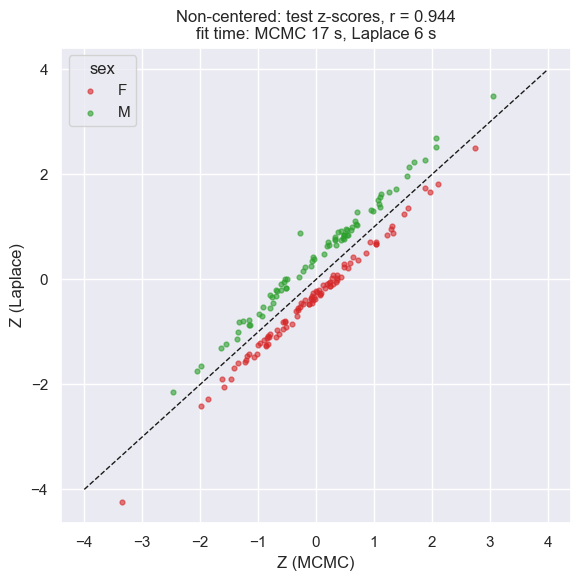
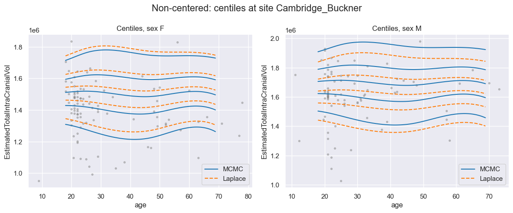
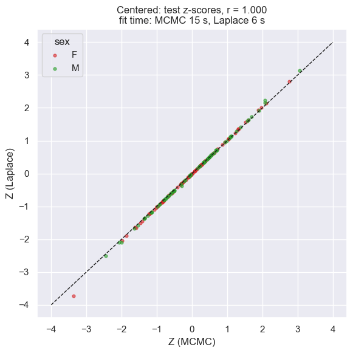
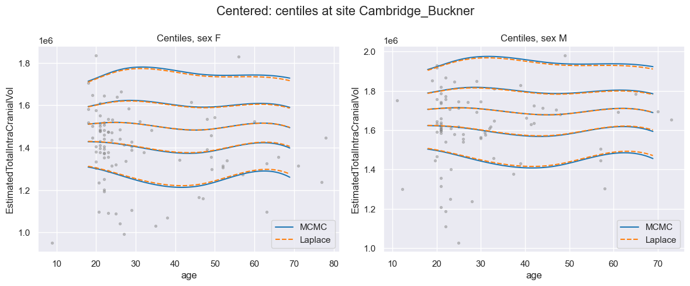
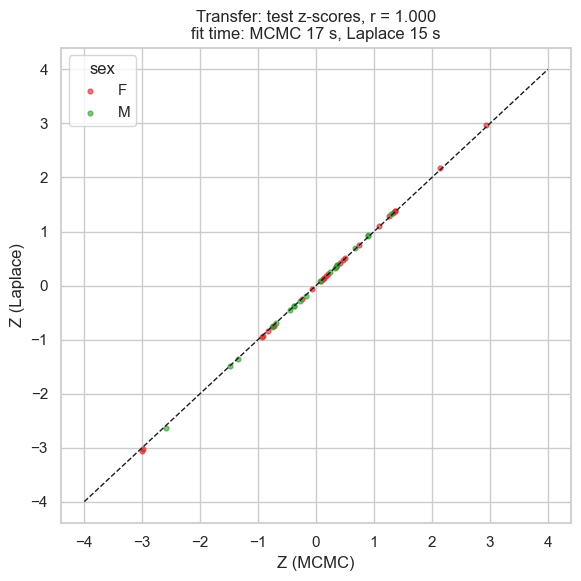
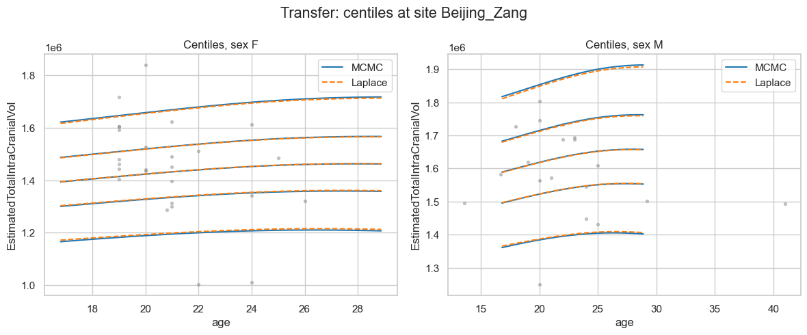
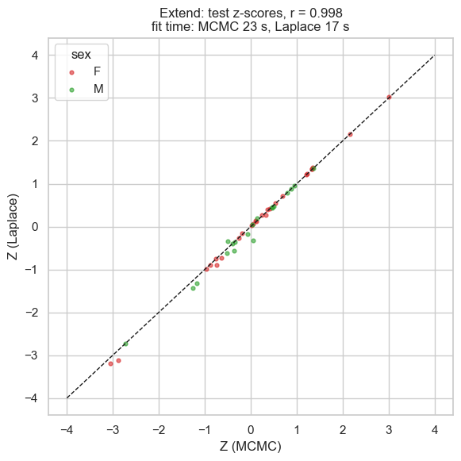
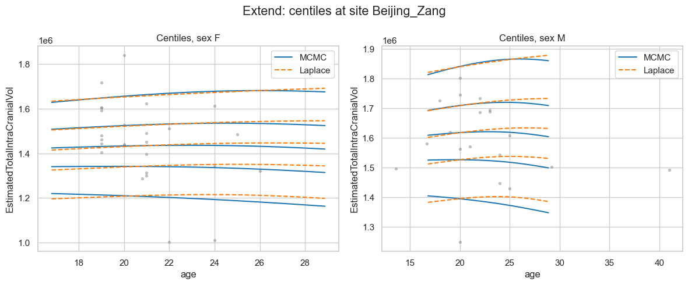

Run HBR faster with approximate inference
=========================================

.. container:: notebook-download

   :download:`Download Jupyter notebook <notebooks/17_HBR_Laplace.ipynb>`

The ``HBR()`` class has an ``inference_method`` argument, which sets how
the model is fitted: ``MCMC()`` by default, or ``Laplace()``.

``Laplace`` approximates the posterior instead of sampling it like
``MCMC``. This can **speed up** the HBR, but it can misestimate group
effects such as site or sex, especially when there are few groups or few
subjects per group.

This notebook shows three things:

1. With the default (non-centered) priors, Laplace shifts the z-scores
   of women and men in opposite directions.
2. A centered random intercept fixes this.
3. With centered priors, Laplace stays close to MCMC after transfer and
   extend to new sites.

.. code:: ipython3

    import logging
    import time
    import warnings
    
    import matplotlib.pyplot as plt
    import numpy as np
    import pandas as pd
    
    from pcntoolkit import HBR, MCMC, Laplace, NormativeModel, NormData, load_fcon1000
    from pcntoolkit.math_functions.likelihood import get_default_normal_likelihood
    from pcntoolkit.math_functions.prior import make_prior
    from pcntoolkit.util.output import Output
    
    # Keep the output clean: no logs, warnings or progress messages
    warnings.filterwarnings("ignore")
    logging.getLogger("pymc").setLevel(logging.ERROR)
    Output.set_show_messages(False)
    Output.set_show_warnings(False)

.. code:: ipython3

    RV = "EstimatedTotalIntraCranialVol"
    ADAPT_SITES = ["AnnArbor_a", "Beijing_Zang"]
    
    fcon = load_fcon1000().sel({"response_vars": [RV]})
    adapt_sites, base = fcon.batch_effects_split({"site": ADAPT_SITES}, names=("adapt_sites", "base"))
    train, test = base.train_test_split((0.8, 0.2), split_names=("train", "test"))
    adapt_train, adapt_test = adapt_sites.train_test_split((0.8, 0.2), split_names=("train", "test"))

.. code:: ipython3

    CENTILES = [0.05, 0.25, 0.5, 0.75, 0.95]
    STYLE = {"MCMC": dict(color="tab:blue", ls="-"), "Laplace": dict(color="tab:orange", ls="--")}
    plt.rcParams["font.size"] = 13  # stays readable when the website shrinks the figures
    
    
    def likelihood(centered: bool):
        """Default Normal likelihood with a centered or non-centered random intercept."""
        lik = get_default_normal_likelihood()
        lik.mu.intercept = make_prior(
            "intercept_mu",
            random=True,
            centered=centered,
            mu=make_prior(dist_params=(0, 1)),
            sigma=make_prior(dist_name="Gamma", dist_params=(1, 0.5)),
        )
        return lik
    
    
    def inference_method(name: str):
        if name == "MCMC":
            return MCMC(draws=1000, tune=1000, chains=4, cores=4, progressbar=False)
        return Laplace(progressbar=False)
    
    
    def fit(centered: bool):
        """Fit MCMC and Laplace on the base sites."""
        models, seconds = {}, {}
        for name in STYLE:
            models[name] = NormativeModel(
                HBR(likelihood=likelihood(centered), inference_method=inference_method(name)),
                save_dir=f"resources/hbr_inference/{'centered' if centered else 'noncentered'}_{name}",
                savemodel=False, saveresults=False, saveplots=False,
            )
            start = time.perf_counter()
            models[name].fit(train)
            seconds[name] = time.perf_counter() - start
        return models, seconds
    
    
    def adapt(models, method: str):
        """Transfer or extend both models to the new sites."""
        adapt_models, seconds = {}, {}
        for name, model in models.items():
            step = model.transfer if method == "transfer" else model.extend
            start = time.perf_counter()
            adapt_models[name] = step(adapt_train, save_dir=f"resources/hbr_inference/{method}_{name}")
            seconds[name] = time.perf_counter() - start
        return adapt_models, seconds
    
    
    def centiles(model, ages, site, sex):
        """Centile curves (centile x age) for one site and sex."""
        grid = pd.DataFrame({"age": ages, "site": site, "sex": sex, RV: 1e-6})
        d = NormData.from_dataframe("grid", dataframe=grid, covariates=["age"],
                                    response_vars=[RV], batch_effects=["site", "sex"])
        model.compute_centiles(d, centiles=CENTILES)
        return d["centiles"].sel(response_vars=RV).values
    
    
    def compare(models, seconds, data, site, title):
        """Plot z-scores of MCMC vs Laplace on `data`, then their centiles at `site`."""
        z = {}
        for name, model in models.items():
            d = data.copy(deep=True)
            model.predict(d)
            z[name] = d["Z"].values.ravel()
        sex = data["batch_effects"].sel(batch_effect_dims="sex").values
        age = data.X.sel(covariates="age").values.ravel()
        y = data.Y.values.ravel()
        ages = np.linspace(*np.percentile(age, [2.5, 97.5]), 100)
    
        # Figure 1: z-scores
        fig, ax = plt.subplots(figsize=(6, 6))
        for s, color in [("F", "tab:red"), ("M", "tab:green")]:
            ax.scatter(z["MCMC"][sex == s], z["Laplace"][sex == s], s=12, alpha=0.6, color=color, label=s)
        ax.plot([-4, 4], [-4, 4], "k--", lw=1)
        r = np.corrcoef(z["MCMC"], z["Laplace"])[0, 1]
        ax.set(xlabel="Z (MCMC)", ylabel="Z (Laplace)",
               title=f"{title}: test z-scores, r = {r:.3f}\n"
                     f"fit time: MCMC {seconds['MCMC']:.0f} s, Laplace {seconds['Laplace']:.0f} s")
        ax.legend(title="sex")
        fig.tight_layout()
        plt.show()
    
        # Figure 2: centiles
        fig, axes = plt.subplots(1, 2, figsize=(12, 5))
        for ax, s in zip(axes, ["F", "M"]):
            ax.scatter(age[sex == s], y[sex == s], s=8, color="grey", alpha=0.4)
            for name in models:
                c = centiles(models[name], ages, site, s)
                for j in range(len(CENTILES)):
                    ax.plot(ages, c[j], lw=1.5, **STYLE[name], label=name if j == 0 else None)
            ax.set(xlabel="age", ylabel=RV, title=f"Centiles, sex {s}")
            ax.legend()
        fig.suptitle(f"{title}: centiles at site {site}")
        fig.tight_layout()
        plt.show()
    
    
    BASE_SITE = pd.Series(train["batch_effects"].sel(batch_effect_dims="site").values).mode()[0]

1. Default (non-centered) priors
--------------------------------

Laplace’s z-scores split into two bands, one per sex, and its centiles
shift away from MCMC.

Also we see that Laplace is significantly faster than MCMC.

.. code:: ipython3

    noncentered, seconds = fit(centered=False)
    compare(noncentered, seconds, test, BASE_SITE, "Non-centered")

2. Centered priors
------------------

The only change is ``centered=True`` on the random intercept. Laplace
results are closer to MCMC now.

.. code:: ipython3

    centered, seconds = fit(centered=True)
    compare(centered, seconds, test, BASE_SITE, "Centered")

3. Transfer to new sites
------------------------

Starting from the centered models, evaluated on the new sites’ test
subjects.

.. code:: ipython3

    transferred, seconds = adapt(centered, "transfer")
    compare(transferred, seconds, adapt_test, "Beijing_Zang", "Transfer")

4. Extend to new sites
----------------------

Extend has slightly less agreement than transfer. Most likely because
each method extends with its own random synthetic data, so the two
models are not fitted on the same data.

.. code:: ipython3

    extended, seconds = adapt(centered, "extend")
    compare(extended, seconds, adapt_test, "Beijing_Zang", "Extend")

